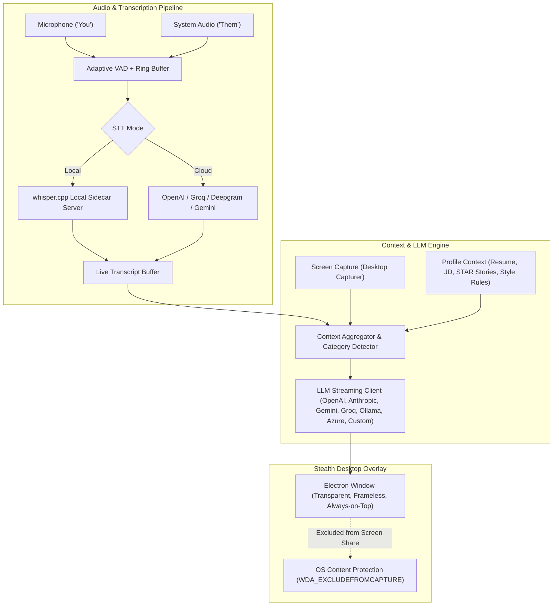

# Donna 🎙️💻

> **A discreet, real-time AI desktop copilot for live interviews, meetings, and coding sessions.**

Donna is a floating, transparent desktop overlay designed to assist you in real time during video calls, technical screenings, interviews, and team discussions. By combining dual-channel audio capture (microphone and system audio), screen capture, and personal profile context (resume, job description, STAR stories), Donna listens, contextualizes, and delivers actionable, verbatim responses right when you need them.

---

## 🌟 Key Features

### 🛡️ Screen Share Invisibility & Stealth Overlay
- **Excluded from Screen Capture**: Configured with OS-level content protection (`setContentProtection(true)` on Windows 10 build 19041+ via `WDA_EXCLUDEFROMCAPTURE` and macOS). Donna remains invisible when you share your entire screen or a window in Zoom, Microsoft Teams, Google Meet, Slack, or Discord.
- **Glass Floating UI**: Frameless, transparent, always-on-top overlay with draggable toolbar, adjustable opacity, and passthrough mode.

### 🎙️ Dual-Channel Audio & Real-Time Transcription
- **Dual-Channel Capture**: Simultaneously transcribes **"You"** (microphone) and **"Them"** (system loopback audio / meeting participants).
- **Adaptive VAD**: Voice Activity Detection with 300ms pre-speech audio ring buffers to ensure speech starts are never clipped.
- **Offline Local Transcription**: Embedded [`whisper.cpp`](https://github.com/ggerganov/whisper.cpp) sidecar runtime with in-memory model reuse, supporting 30+ Whisper model variants (tiny to large-v3-turbo) with zero cloud dependencies.
- **Ultra-Fast Cloud STT**: Seamless integration with Deepgram (streaming WebSocket STT), Groq (`whisper-large-v3-turbo`), OpenAI (`whisper-1`), and Google Gemini Flash.

### 🧠 Multi-Provider LLM Engine
- Switch seamlessly between top providers:
  - **OpenAI** (GPT-4o, GPT-4o-mini)
  - **Anthropic** (Claude 3.5 Sonnet, Claude 3.5 Haiku)
  - **Google Gemini** (Gemini 2.0 Flash, Gemini 1.5 Pro)
  - **Groq** (Llama 3.3 70B, Llama 3.1 8B)
  - **Ollama** (Local offline LLMs like Llama 3.2, Llama 3.3)
  - **MiniMax** (MiniMax-M2.7, MiniMax-M3 with Global and China endpoints)
  - **Azure AI Foundry / Azure OpenAI**
  - **Custom OpenAI-Compatible Endpoints** (vLLM, LM Studio, LocalAI)
- **Fast / Smart Tier Switching**: Instant toggle between low-latency models for rapid answers and reasoning models for complex questions.

### 🎯 Interview Intelligence & Personalization
- **Resume & Job Description Parsing**: Ingest resumes and target JDs directly via PDF, DOCX, or plain text.
- **STAR Stories & Behavioral Prep**: Store your real Situation-Task-Action-Result stories so generated answers use your authentic experience with real metrics.
- **Automatic Question Category Detection**: Intelligently identifies Behavioral, Technical, Motivational, Situational, Compensation, or Company-specific questions and tailors answers accordingly.
- **Custom AI Writing Rules**: Define exact behavioral guidelines (e.g. *"Use short bullet points"*, *"Casual first-person tone"*, *"Never use em-dashes"*).

### ⚡ Real-Time Copilot Modes
| Mode | Shortcut | Description |
| :--- | :--- | :--- |
| **Assist** | `Ctrl+Enter` / `Cmd+Enter` | Analyzes live screenshot + conversation transcript to suggest what to do or say right now. |
| **Say** | `Ctrl+Shift+Enter` / `Cmd+Shift+Enter` | Drafts a 2–5 sentence, natural first-person answer ready to speak out loud. |
| **LeetCode** | `Ctrl+H` / `Cmd+H` | Scans screen for coding problems and outputs restatement, optimal approach, clean code, and time/space complexity. |
| **Follow-up** | *UI Action* | Suggests 2–4 sharp, curious questions to ask the interviewer. |
| **Recap** | *UI Action* | Provides a structured bulleted summary of topics covered, questions asked, and points to strengthen. |
| **Answer This** | *Transcript Click* | Click any specific transcribed question to generate a targeted answer. |
| **Ask** | *Input Box* | Free-form prompt with full screenshot and rolling transcript context. |

### 📝 Meeting Notes & History
- Automatic 5-part structured meeting notes: **Summary**, **Key Points**, **Decisions**, **Action Items**, and **Follow-Ups**.
- Local searchable meeting history stored securely on your machine.

### 🔒 Privacy First
- **No Third-Party Relay**: API keys and profiles are stored strictly on your local disk in `donna-data.json`.
- Direct client-to-provider requests without external middleman servers.

---

## ⌨️ Global Shortcuts

| Shortcut (Windows / Linux) | Shortcut (macOS) | Action |
| :--- | :--- | :--- |
| <kbd>Ctrl</kbd> + <kbd>Enter</kbd> | <kbd>Cmd</kbd> + <kbd>Enter</kbd> | **Assist**: Context + screen analysis |
| <kbd>Ctrl</kbd> + <kbd>Shift</kbd> + <kbd>Enter</kbd> | <kbd>Cmd</kbd> + <kbd>Shift</kbd> + <kbd>Enter</kbd> | **Say**: Draft next spoken response |
| <kbd>Ctrl</kbd> + <kbd>H</kbd> | <kbd>Cmd</kbd> + <kbd>H</kbd> | **LeetCode**: Solve code problem on screen |
| <kbd>Ctrl</kbd> + <kbd>Shift</kbd> + <kbd>/</kbd> | <kbd>Cmd</kbd> + <kbd>Shift</kbd> + <kbd>/</kbd> | Toggle overlay visibility (Hide / Show) |
| <kbd>Ctrl</kbd> + <kbd>Shift</kbd> + <kbd>X</kbd> | <kbd>Cmd</kbd> + <kbd>Shift</kbd> + <kbd>X</kbd> | Quit Donna |

---

## 🏗️ Architecture



---

## 🚀 Getting Started

### Prerequisites
- **Node.js**: `>= 22.12.0`
- **npm**: `>= 10.0.0`
- *(Optional for building local whisper.cpp on macOS)*: `cmake` and Xcode command line tools. On Windows/Linux, pinned pre-built binaries are downloaded automatically by the runtime script.

### Installation

1. **Clone the repository:**
   ```bash
   git clone https://github.com/your-username/donna.git
   cd donna
   ```

2. **Install dependencies:**
   ```bash
   npm install
   ```

3. **(Optional) Prepare the local Whisper runtime:**
   If you plan to use 100% offline local transcription with `whisper.cpp`:
   ```bash
   npm run prepare:whisper
   ```
   To verify runtime readiness:
   ```bash
   npm run verify:whisper-runtime
   ```

4. **Launch Donna in development mode:**
   ```bash
   npm start
   ```

---

## ⚙️ Configuration

Open Donna's **Settings** panel (click the gear icon or `...` menu):

1. **Keys & Providers**:
   - Choose your LLM provider (OpenAI, Anthropic, Gemini, Groq, Ollama, MiniMax, Azure, or Custom).
   - Enter the API key for your chosen provider.
   - Configure **Fast** (e.g. `gpt-4o-mini`, `claude-3-5-haiku-latest`, `gemini-2.0-flash`) and **Smart** models (e.g. `gpt-4o`, `claude-3-5-sonnet-latest`).
2. **Audio & Transcription**:
   - Select your preferred STT provider: `Auto`, `Local`, `Deepgram`, `OpenAI`, or `Gemini`.
   - In `Local` mode, download or import your desired Whisper model (e.g., `base.en`, `small.en`, `medium.en`, `large-v3-turbo`).
3. **Profile**:
   - Import or paste your **Resume** (PDF/DOCX/text).
   - Paste the target **Job Description**.
4. **Interview Prep**:
   - Add your **STAR Stories** (Situation, Task, Action, Result).
   - Fill in answers for *"Why this company"*, *"Why leaving"*, and *"Work style & values"*.
5. **Style Rules**:
   - Add custom instructions for how Donna should format responses (max 2,000 characters).

---

## 🧪 Running Tests

Donna has a comprehensive test suite covering audio processing, VAD, Whisper runtime lifecycle, LLM streaming, meeting memory, and context generation:

```bash
# On Unix / macOS
npm test

# On Windows PowerShell
node --test (Get-ChildItem test/*.test.js | Select-Object -ExpandProperty FullName)
```

---

## 📦 Packaging & Distribution

Donna uses `electron-builder` for multi-platform distribution.

```bash
# Package directory without installer
npm run pack

# Build Windows installer (.exe)
npm run dist:win

# Build macOS package (.zip / .dmg)
npm run dist:mac

# Build Linux AppImage (x64 / arm64)
npm run dist:linux
npm run dist:linux:arm64
```

> **Note on bundling local Whisper in release builds:**  
> By default, `electron-builder` skips packaging the local Whisper binary to keep builds fast and lightweight. To bundle the `whisper.cpp` runtime into your installer, set the environment variable:
> ```bash
> DONNA_BUNDLE_WHISPER=1 npm run dist:win
> ```

---

## 🔒 Privacy & Permissions

- **Microphone**: Required to capture your voice.
- **System Audio / Screen Recording**: Required to capture incoming meeting audio ("Them") via loopback and capture screen regions for the `Assist` and `LeetCode` modes.
- **Data Storage**: All transcripts, meeting notes, settings, and profile information reside locally in Electron's `userData` directory (`donna-data.json` and `meetings.json`). No telemetry or user data is sold or sent to centralized Donna servers.

---

## 📄 License

All rights reserved.
Third-party libraries and runtimes (including `whisper.cpp`) remain subject to their respective licenses.
